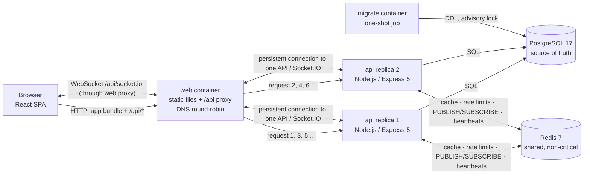
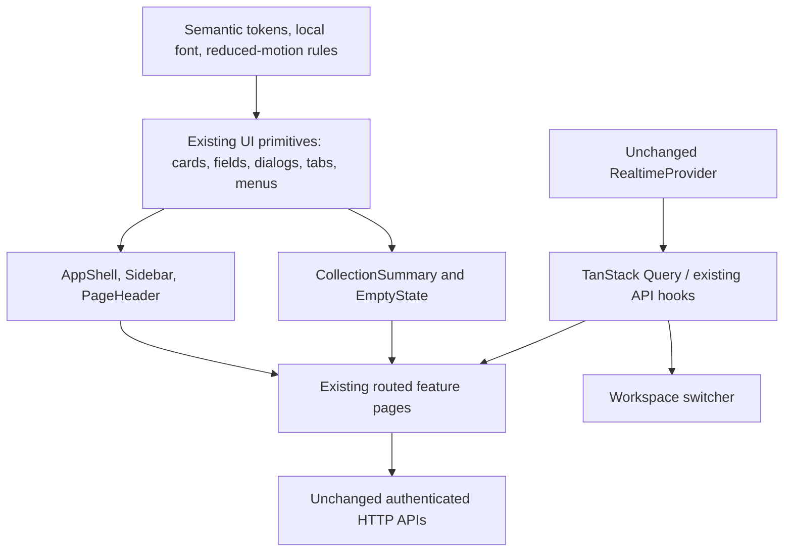
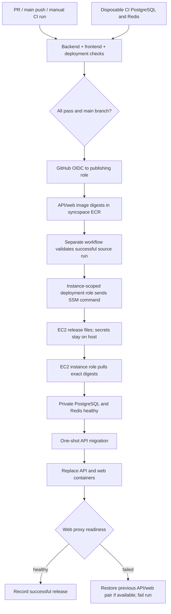
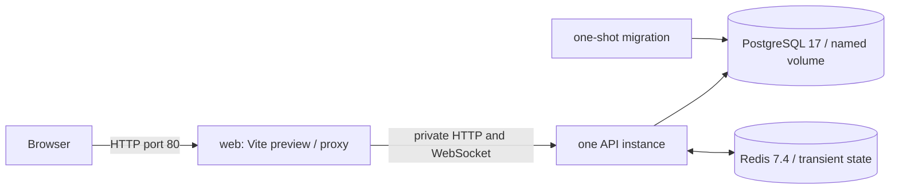

# SyncSpace: System Design Guide

Simple introduction: [SyncSpace Architecture — Simple PDF](docs/SyncSpace_Architecture_Simple.pdf) explains the historical Phase 3 browser-to-database journey in three short pages; the current Phase 4 live flow is documented below.

> **Status:** Phases 1–4 of the current **eleven-phase roadmap** are implemented (identity & foundation; workspaces, projects, tasks & Kanban; Redis caching, distributed rate limiting & multiple API instances).
> Last assessed: **2026-11-05 (Asia/Kolkata)**. Phase 4 verification: 105 backend tests, 38 frontend tests, both TypeScript checks and production builds pass. A Playwright scenario proved live boards/chat across two separate API containers, proxy upgrades, reconnect recovery and mobile chat layout. Earlier “measured” Phase 3 examples remain historical evidence; §15 describes current behavior.
> This guide distinguishes implemented architecture from explicitly planned flows. See [PROJECT_UNDERSTANDING.md](PROJECT_UNDERSTANDING.md) for the codebase assessment and [IMPLEMENTATION_TRACKER.md](IMPLEMENTATION_TRACKER.md) for verification and approval status. Phase 4 was authorized on 2026-11-05 and is ready for acceptance review. Phase 5 awaits further approval.
> The in-app **Architecture Explorer** (`/architecture`) is generated from
> `frontend/src/features/architecture/architecture-data.ts`. Keep that file and this guide in sync (see [§12](#12-keeping-this-guide-honest)).
> **Roadmap numbering:** this guide and the Explorer follow the current eleven-phase roadmap (§13). The handoff retains its historical eight-phase grouping.

---

## 1. What SyncSpace is

SyncSpace is being built as a real-time project collaboration platform. Workspaces, projects, Kanban boards and activity history exist today; browser real-time updates, team chat, presence and transient task/chat notifications now work through Phase 4. Durable notifications remain Phase 5 work. Each phase adds working features and the infrastructure they need.

Phase 1 delivers the foundation every later feature depends on:

| Capability | Where |
|---|---|
| Registration, login, logout, "sign out everywhere" | `backend/src/modules/auth` |
| Short-lived JWT access tokens + rotating, revocable refresh sessions | `auth.service.ts`, `token.service.ts` |
| Profile read/update | `backend/src/modules/users` |
| Liveness/readiness health checks | `backend/src/modules/health` |
| Versioned SQL migrations run as a one-shot job | `backend/src/infrastructure/database/migrator.ts` |
| SaaS shell: sidebar, dark/light theme, dashboard, settings, system health | `frontend/src` |
| Architecture Explorer with animated flows and "Explain this component" | `frontend/src/features/architecture` |
| OpenAPI docs | `GET /api/docs` |

Phase 2 adds the collaboration core on the same infrastructure (no new containers):

| Capability | Where |
|---|---|
| Workspaces with owner / admin / member roles; add members by email | `backend/src/modules/workspaces` |
| One authorisation gate for everything inside a workspace | `workspaces/workspace-access.ts` |
| Projects with immutable keys (`WEB`) and task ids (`WEB-12`) | `backend/src/modules/projects` |
| Task CRUD, Kanban moves (fractional positions), optimistic concurrency | `backend/src/modules/tasks` |
| Activity history, written in the same transaction as each change | `backend/src/modules/activity` |
| My Tasks and dashboard counts across all workspaces | `backend/src/modules/me` |
| Workspaces, members, projects, Kanban board (drag & drop + keyboard), task sheet, My Tasks, dashboard | `frontend/src/features/{workspaces,projects,board,tasks,dashboard,work}` |

Phase 3 adds Redis and runs the API as several instances:

| Capability | Where |
|---|---|
| API runs as N stateless replicas (`deploy.replicas`, default 2); every response names its instance (`x-served-by`) | `docker-compose.yml`, `backend/src/app.ts` |
| Load balancing: the web proxy round-robins over every replica Docker's DNS returns | `frontend/vite.config.ts` |
| Cache-aside with generation-based invalidation for boards, project headers and member lists (`x-cache: HIT/MISS/BYPASS`) | `backend/src/infrastructure/cache/cache.ts` |
| Distributed fixed-window rate limiting (credentials + all `/api` traffic), fail-open | `backend/src/infrastructure/rate-limit/rate-limit.ts` |
| Domain events over Redis Pub/Sub after every committed write, de-duplicated by id | `backend/src/infrastructure/events/`, `backend/src/shared/after-commit.ts` |
| Instance registry via TTL heartbeats; cluster view, event stream and load-balancing demo on System Health | `backend/src/modules/system/`, `frontend/src/features/health/` |

---

## 2. Architecture (as implemented through Phase 4)



```
                                               ┌──────────────────┐   SQL    ┌───────────────┐
 ┌──────────┐  HTTP   ┌──────────────────┐ ┌──▶│ api replica 1    │────────▶│ PostgreSQL 17 │◀── migrate (job)
 │ Browser  │───────▶│ web: static +     │─┤   └────────┬─────────┘         └───────▲───────┘
 │ React SPA│◀───────│ /api round-robin  │ │   ┌────────┴─────────┐   SQL           │
 └──────────┘         └──────────────────┘ └──▶│ api replica 2    │─────────────────┘
                                               └────────┬─────────┘
                           cache · rate limits · pub/sub · heartbeats (both replicas)
                                               ┌────────▼─────────┐
                                               │ Redis 7          │
                                               └──────────────────┘
```

The ASCII sketch below the Mermaid diagram illustrates the HTTP/data path; Socket.IO runs inside each API process, not as an extra container.

### Components

| Component | Container | Role | Talks to |
|---|---|---|---|
| **Browser client** | n/a | React 19 + TypeScript SPA. Keeps the access token **in memory only**. | web |
| **Web server & load balancer** | `web` | Serves the compiled bundle and proxies `/api/*` to the API, so UI and API share one origin. Resolves `api` to every replica and rotates connections (DNS round-robin, keep-alive off). *Replaced by Nginx in Phase 8.* | browser, api |
| **Node.js API ×N** | `api` (replicas: `API_REPLICAS`, default 2) | Express 5 modular monolith: auth, users, health, workspaces, projects, tasks, activity, me, system. Stateless: any instance can serve any request. Each replica gets a free host port in 4001–4004 (see `docker compose ps`) for direct access. | web, PostgreSQL, Redis |
| **Socket.IO gateway** | inside each `api` | Authenticated WebSocket-only connections, authorized workspace/user rooms, local delivery from the shared event bus, presence and chat actions. | browser through web proxy, PostgreSQL, Redis |
| **Redis 7** | `redis` | Shared, non-authoritative state: cache, rate-limit counters, Pub/Sub channel `syncspace:events`, instance heartbeats and expiring presence leases. Password-protected, no persistence, `maxmemory 256mb` + `allkeys-lru`. | api |
| **PostgreSQL 17** | `postgres` | Source of truth for identity, membership, projects, tasks and history. Volume `postgres-data`. | api, migrate |
| **Migration job** | `migrate` | Applies `backend/migrations/*.sql`, then exits. The API starts only if it succeeds. | PostgreSQL |

### Why each technology

| Technology | Why it is here now |
|---|---|
| **React + Vite + TypeScript** | Fast SPA with type-safe API contracts; Vite gives instant dev reloads and an optimised production build. |
| **Tailwind + shadcn/ui** | Consistent, accessible components whose source lives in the repo (`components/ui`), so nothing is a black box. |
| **React Query** | Server-state cache: deduplicates requests, refetches in the background (System Health polls every 5 s). |
| **React Flow** | Renders the live architecture diagram and animated request flows. |
| **dnd-kit** | Accessible drag-and-drop for the board (pointer *and* keyboard: Space to pick up, arrows to move). |
| **Radix (dialog, select, tabs) + sonner** | Accessible primitives behind the shadcn/ui components; toasts for async outcomes such as move conflicts. |
| **Express 5** | Minimal, explicit request pipeline; v5 forwards async errors to the error handler natively. |
| **PostgreSQL** | Relational data with transactions, FKs, unique constraints and row locks (used for race-free token rotation). |
| **Zod** | One schema both validates input and gives the TypeScript type. |
| **pino** | Structured JSON logs with request IDs and secret redaction. |
| **jose / bcryptjs** | Standards-compliant JWT signing; adaptive password hashing (pure JS, no native build). |
| **Docker Compose** | One command brings up the whole stack with health-checked startup ordering; `deploy.replicas` / `--scale api=N` for horizontal scaling. |
| **Redis + ioredis** | One shared, sub-millisecond store that every instance sees: what makes caching, rate limiting and event fan-out correct with more than one instance. ioredis is configured to fail fast (no offline queue, 500 ms command timeout). |

Not used yet: RabbitMQ, MinIO, Elasticsearch, Nginx, Prometheus/Grafana and Kafka each arrive in the phase whose features need them. Phase 2 needed none of them. Phase 3 needed Redis because the moment there are two API instances, in-memory caches, counters and notifications stop being shared.

---

## 3. Repository layout

```
SyncSpace/
├── docker-compose.yml            # postgres → migrate → api → web, with health checks
├── .env.example                  # template; ./scripts/init-env.sh creates .env with random secrets
├── scripts/init-env.sh
├── docker/postgres/init/         # first-boot SQL: creates the syncspace_test database
├── SYSTEM_DESIGN_GUIDE.md        # this file
│
├── backend/                      # Node.js API (modular monolith)
│   ├── migrations/               # NNN_name.sql, applied in order, never edited once applied
│   ├── src/
│   │   ├── server.ts             # HTTP server + graceful shutdown
│   │   ├── app.ts                # Express app factory (middleware + module routers)
│   │   ├── config/env.ts         # Zod-validated environment; process refuses to start if invalid
│   │   ├── docs/openapi.ts       # OpenAPI 3.1 document served at /api/docs
│   │   ├── infrastructure/       # technical adapters, no business rules
│   │   │   ├── database/         # pg pool, transactions, migration runner + CLI
│   │   │   ├── redis/            # fail-fast ioredis connections (commands + subscriber)
│   │   │   ├── cache/            # generation-keyed cache-aside
│   │   │   ├── rate-limit/       # Redis fixed-window limiter middleware
│   │   │   ├── events/           # Pub/Sub event bus with de-duplication
│   │   │   ├── instance.ts       # instance identity (container DNS name) + counters
│   │   │   └── logging/          # pino logger
│   │   ├── shared/               # cross-module: AppError, validate, authenticate, error handler,
│   │   │                         #   after-commit.ts (invalidate cache + publish event)
│   │   └── modules/              # one folder per business capability
│   │       ├── auth/             # routes → service → repositories; tokens, cookies, passwords
│   │       ├── users/            # user repository + /users/me
│   │       ├── health/           # /health/live, /health/ready
│   │       ├── workspaces/       # workspaces, members, workspace-access.ts (authorisation gate)
│   │       ├── projects/         # projects; requireProjectAccess()
│   │       ├── tasks/            # tasks, moves, positioning.ts (fractional order)
│   │       ├── activity/         # activity_logs repository + query parsing
│   │       ├── me/               # /me/tasks, /me/dashboard
│   │       └── system/           # /system/instances, /system/events, heartbeat registry, event log
│   └── tests/
│       ├── unit/                 # pure logic: tokens, schemas, config
│       └── integration/          # real HTTP (supertest) against a real PostgreSQL test DB
│
└── frontend/                     # React SPA
    └── src/
        ├── main.tsx / App.tsx    # providers + routes
        ├── lib/                  # api-client (token handling), queries, utils
        ├── providers/            # theme
        ├── components/ui/        # shadcn/ui primitives
        ├── components/layout/    # app shell, sidebar, navigation (CURRENT_PHASE lives here)
        └── features/
            ├── work/             # shared: API hooks (React Query), types, badges, activity feed
            ├── workspaces/       # list, detail tabs, members, settings
            ├── projects/         # list, create dialog, cards
            ├── board/            # Kanban (dnd-kit), board-logic.ts, task sheet, new-task dialog
            ├── tasks/            # My Tasks
            └── auth, dashboard, architecture, health, settings
```

**Module rule:** a module may import another module's *exported service or repository*, never reach into its tables directly. Examples: `auth` uses `userRepository`; `tasks` uses `requireProjectAccess` and `activityRepository`. This is the seam along which a module can later become its own service. (One pragmatic exception: `workspaceRepository.removeMember` also unassigns that user's tasks in the same transaction, to keep the invariant "assignees are members".)

---

## 4. Communication patterns

| From → To | Protocol | Pattern | Notes |
|---|---|---|---|
| Browser → web | HTTP | Request/response | Same origin for UI and API. |
| web → api replicas | HTTP proxy | Request/response, round-robin | Adds `X-Forwarded-For`; API sets `trust proxy = 1`. A new connection per request, each to the next replica. |
| api → Redis (commands) | RESP | Request/response | Cache reads/writes, `INCR` for generations and rate limits, heartbeats. Fails fast; every caller has a fallback. |
| api → Redis → every api | RESP Pub/Sub | **Publish/subscribe (fan-out)** | `PUBLISH syncspace:events` after commit; one dedicated subscriber connection per instance. At-most-once delivery. |
| api → PostgreSQL | PostgreSQL wire protocol | Pooled connections | Parameterised queries only. Transactions via `withTransaction()`. |
| migrate → PostgreSQL | PostgreSQL wire protocol | One-shot | `pg_advisory_lock` serialises concurrent migrators. |
| Docker → api/web/postgres | HTTP / `pg_isready` | Health probes | Drives `depends_on: condition: service_healthy`. |

Browser ↔ server communication uses HTTP for authorized data reads/writes and Socket.IO for live ID-only signals, presence and typing. Every committed domain write is announced over Redis Pub/Sub; each API delivers to its authorized local sockets. React Query refetches affected views and reconciles after reconnect. RabbitMQ (Phase 5) will add durable jobs.

### REST API

| Method & path | Auth | Purpose |
|---|---|---|
| `POST /api/auth/register` | none (rate-limited) | Create account, start session |
| `POST /api/auth/login` | none (rate-limited) | Start session |
| `POST /api/auth/refresh` | refresh cookie | Rotate refresh token, new access token |
| `POST /api/auth/logout` | refresh cookie | End this session |
| `POST /api/auth/logout-all` | Bearer | End every session of this user |
| `GET /api/auth/sessions` | Bearer (+ cookie to mark current) | List active sign-ins |
| `GET /api/users/me` | Bearer | Profile |
| `PATCH /api/users/me` | Bearer | Update display name |
| `GET /api/health/live` | none | Liveness |
| `GET /api/health/ready` | none | Readiness: 503 if PostgreSQL is down; 200 with `status: "degraded"` if only Redis is down |
| `GET /api/docs` | none | Swagger UI (`/api/docs/openapi.json` for the raw spec) |
| `GET, POST /api/workspaces` | Bearer | My workspaces / create (caller becomes owner) |
| `GET, PATCH, DELETE /api/workspaces/:id` | member / admin / owner | Read / rename / delete |
| `GET, POST /api/workspaces/:id/members` | member / admin | List / add existing user by email |
| `PATCH, DELETE /api/workspaces/:id/members/:userId` | admin (or self to leave) | Change role / remove |
| `GET, POST /api/workspaces/:id/projects` | member / admin | List / create project |
| `GET /api/projects` | Bearer | Projects across all my workspaces |
| `GET, PATCH, DELETE /api/projects/:id` | member / admin / admin | Read / rename / delete |
| `GET, POST /api/projects/:id/tasks` | member | Board (all tasks by position) / create task |
| `GET, PATCH, DELETE /api/tasks/:id` | member (delete: reporter or admin) | Read / update (with `version`) / delete |
| `POST /api/tasks/:id/move` | member | Kanban move `{ status, afterTaskId, version }` |
| `GET /api/{workspaces,projects,tasks}/:id/activity` | member | History, newest first, `?limit=&before=` cursor |
| `GET /api/me/tasks?scope=open\|all`, `GET /api/me/dashboard` | Bearer | Cross-workspace views |
| `GET /api/system/instances` | Bearer | Live instances (heartbeat registry) with per-instance metrics, plus Redis `INFO` |
| `GET /api/system/events` | Bearer | Events received by the serving instance, filtered to the caller's workspaces |

**Response headers (Phase 3):** `x-served-by` (instance) on every response; `x-cache: HIT | MISS | BYPASS` on cached reads (`GET /projects/:id`, `/projects/:id/tasks`, `/workspaces/:id/members`); `RateLimit-Limit/Remaining/Reset` on every `/api` response except health checks; `Retry-After` on 429.

**Authorisation rule:** every workspace-scoped request resolves the workspace (directly, or via project → workspace, or task → workspace) and calls `requireWorkspaceRole(workspaceId, userId, minimumRole)`. Not a member → **404** (outsiders cannot even learn an id exists). Member with too low a role → **403**.

Every error has the same shape: `{ "error": { "code", "message", "details?", "requestId" } }`.

---

## 5. Data model

```sql
users (
  id UUID PK, email TEXT UNIQUE (lower-case enforced), password_hash TEXT,
  display_name TEXT (1–80 chars), created_at, updated_at, last_login_at
)

refresh_tokens (
  id UUID PK, user_id → users ON DELETE CASCADE,
  family_id UUID,            -- one per login; all rotations of that login share it
  token_hash TEXT UNIQUE,    -- SHA-256 of the token; the token itself is never stored
  expires_at, created_at,
  revoked_at, revoked_reason ('rotated'|'logout'|'logout_all'|'reuse_detected'),
  replaced_by → refresh_tokens, user_agent, ip_address
)

workspaces (id, name, description, created_by, created_at, updated_at)
workspace_members (workspace_id, user_id, role 'owner'|'admin'|'member', joined_at)
  PK (workspace_id, user_id); partial UNIQUE index → at most one owner per workspace

projects (id, workspace_id, name, key ~ '^[A-Z][A-Z0-9]{1,5}$', description,
          task_counter INT,            -- last task number handed out
          UNIQUE (workspace_id, key))

tasks (id, project_id, workspace_id (denormalised for auth/my-tasks), number,
       title, description, status, priority, assignee_id, reporter_id, due_date DATE,
       position DOUBLE PRECISION,      -- order within the column
       version INT,                    -- optimistic concurrency
       completed_at, UNIQUE (project_id, number))
  INDEX (project_id, status, position) -- the board query
  INDEX (assignee_id, status)          -- My Tasks

activity_logs (id BIGINT identity, workspace_id, project_id?, task_id?, actor_id,
               action, entity_title (snapshot), metadata JSONB, created_at)

schema_migrations (name PK, checksum, applied_at)
```

### Redis keyspace (Phase 3)

Nothing in Redis is authoritative; all of it can be lost (Redis runs without persistence).

| Key | Type / TTL | Written by | Purpose |
|---|---|---|---|
| `gen:project:<id>`, `gen:workspace:<id>`, `gen:users` | integer / 2 × cache TTL | `afterCommit` (`INCR`) | Cache generations: part of every cache key |
| `cache:<name>\|<scope>=<gen>…` | JSON string / 300 s | cache-aside reads | Board (`board:<projectId>`), project header (`project:<id>`), member list (`members:<workspaceId>`) |
| `rl:<limiter>:<client ip>:<window #>` | integer / window | rate limiter (`MULTI INCR PEXPIRE`) | `auth`: 20 per 15 min; `api`: 1200 per min |
| `instance:<id>` | JSON / 15 s | heartbeat every 5 s | Instance registry for System Health |
| channel `syncspace:events` | Pub/Sub | `afterCommit` | Domain events: `{id, type, workspaceId, projectId, taskId, actorId, occurredAt, publishedBy}` |

Deleting a workspace cascades to everything inside it. Deleting a project cascades to its tasks and their history, but a `project.deleted` row (with `project_id` NULL) stays in the workspace history. Deleting a task keeps its history rows (`task_id` set NULL), titled by the `entity_title` snapshot.

A "session" shown in Settings is one `family_id` whose newest token is unrevoked and unexpired.

---

## 6. Key flows

### 6.1 Login

1. Browser `POST /api/auth/login {email, password}` → web → api.
2. Rate limiter: 20 attempts / 15 min / IP (`AUTH_RATE_LIMIT_*`).
3. Zod validates and normalises (trim, lower-case email).
4. `SELECT ... FROM users WHERE email = $1`.
5. `bcrypt.compare`. If the email is unknown, a **dummy hash** is compared instead, so timing does not reveal which emails exist. Both cases return the same `401 INVALID_CREDENTIALS`.
6. Generate 256-bit random refresh token → `INSERT refresh_tokens (token_hash = sha256(token), family_id = new uuid)`.
7. Respond: JSON `{ user, accessToken, expiresIn }` and `Set-Cookie: syncspace_rt=…; HttpOnly; SameSite=Strict; Path=/api/auth`.

### 6.2 Authenticated request

`Authorization: Bearer <jwt>` → `authenticate` middleware verifies signature, issuer, audience and expiry with **no database call**. On expiry it returns `401 TOKEN_EXPIRED`; the client's `api-client.ts` then refreshes once and retries the request.

### 6.3 Refresh with rotation and reuse detection

All of this runs inside one transaction:

```
SELECT … FROM refresh_tokens WHERE token_hash = $1 FOR UPDATE   -- row lock: concurrent refreshes serialise
  not found                         → 401 INVALID_REFRESH_TOKEN
  revoked as 'rotated' ≤ 30 s ago   → 401 REFRESH_TOKEN_STALE    (benign multi-tab race; client retries once)
  revoked as 'rotated' > 30 s ago   → revoke whole family, COMMIT, 401 REFRESH_TOKEN_REUSED
  revoked for other reason          → 401 INVALID_REFRESH_TOKEN
  expired                           → 401 REFRESH_TOKEN_EXPIRED
  valid                             → INSERT new token (same family); UPDATE old SET revoked='rotated', replaced_by
```

Why the reuse rule matters: a refresh token is only ever valid once. If an old one shows up again, either an attacker or the real user is holding a stolen copy. The server cannot tell which, so it ends that login for both.

The reuse branch must **commit** the family revocation before answering 401. That is why `authService.refresh` returns the error out of the transaction instead of throwing inside it, which would roll the revocation back.

### 6.4 Page reload

The access token lives in memory, so it is gone after a reload. `AuthProvider` calls `POST /api/auth/refresh` on mount. Concurrent callers share one in-flight promise, which matters because React StrictMode mounts twice in development. The httpOnly cookie silently restores the session.

### 6.5 Creating a task

1. `POST /api/projects/:id/tasks` → Zod validation.
2. Transaction: `requireProjectAccess` (membership) → assignee must be a member → `UPDATE projects SET task_counter = task_counter + 1 RETURNING` (row lock: concurrent creates get distinct, gap-free numbers) → `INSERT tasks` at `max(position) + 1024` of its column → `INSERT activity_logs`.
3. `201` with the full task; React Query invalidates the board, project counts, My Tasks, dashboard.

### 6.6 Moving a card (drag & drop)

1. **Browser:** dnd-kit reports the drop. The board computes `afterTaskId` (the visible card directly above; `null` = top) and calls `useMoveTask`, which **optimistically** rewrites the cached board using the same position rule as the server and keeps a snapshot.
2. `POST /api/tasks/:id/move { status, afterTaskId, version }`.
3. Transaction:
   - `SELECT … FROM projects … FOR NO KEY UPDATE`: serialises writes on this board.
   - `SELECT … FROM tasks … FOR UPDATE`, then a membership check.
   - `version` mismatch → **409 VERSION_CONFLICT** (someone else changed the card first).
   - Position = midpoint of the new neighbours (`positioning.ts`). If the gap is exhausted (< 1e-6 after ~50 inserts into the same gap), the column is re-spaced to 1024, 2048, … and the midpoint recomputed.
   - `UPDATE` status/position, `version + 1`, `completed_at` set/cleared; `task.status_changed` activity if the column changed (pure reordering is not recorded).
4. **Browser:** success → cache takes the server copy; error → snapshot restored, toast, refetch.

**Why fractional positions?** Integer positions would force renumbering every card below the drop point (N row updates and N locks per move). A midpoint touches one row.

**Lock ordering (deadlock prevention).** Every board write takes locks in the same order: *project, then task*. The project lock is `FOR NO KEY UPDATE` rather than `FOR UPDATE` because inserting an `activity_logs` row that references the project takes a foreign-key `KEY SHARE` lock, which `FOR UPDATE` would block. That combination deadlocked under concurrent move + delete. The integration test *"handles concurrent moves and edits on one board without deadlocking"* fails 3/3 with the old locking and passes with the current one.

### 6.7 Concurrent edits (optimistic concurrency)

Every task carries `version`. The client sends the version it displayed; the server rejects a mismatch with 409 and the current version. The UI shows a toast and reloads the task. This is "first writer wins, second writer is told", which is better than "last writer silently wins" for collaborative data and needs no locks held between requests.

### 6.8 Startup (`docker compose up`)

`postgres` and `redis` healthy → `migrate` runs and exits 0 → every `api` replica resolves its own name (PTR lookup of its IP: `syncspace-api-1`), subscribes to `syncspace:events`, starts heartbeating and becomes healthy (`/api/health/ready`) → `web` starts. A replica whose Redis is unreachable at boot still starts; the subscriber subscribes when Redis appears.

### 6.9 Shutdown

`SIGTERM` → stop accepting connections → close idle keep-alive sockets → wait for in-flight requests → delete own heartbeat key (leaves the registry immediately) → unsubscribe → close Redis → close the pg pool → exit. A forced exit happens after 10 s; Compose's `stop_grace_period` is 15 s. Measured: ~0.2 s with no traffic.

### 6.10 Load balancing across replicas

1. Docker's embedded DNS (`127.0.0.11`) answers `api` with one A record per running replica.
2. The web proxy's custom `lookup` calls `dns.resolve4('api')` per connection, sorts the IPs and picks the next one. Keep-alive is off, so every request opens a fresh connection and the rotation applies per request. Measured: 20 requests → 10 / 10.
3. Because the API is stateless (JWT verified by signature, data in PostgreSQL, shared state in Redis), any replica can serve any request, including a token issued by another replica.

**Limits, on purpose:** there are no health checks or retries. A replica that is stopped gracefully disappears from DNS right away (measured: 0 failed requests), but a hung replica would keep getting its share. Nginx (Phase 8) adds health-aware, least-connections balancing.

### 6.11 Cached read (cache-aside with generations)

`GET /api/projects/:id/tasks`:
1. **Authorise in PostgreSQL**, always: membership is never cached, so a removed member loses access immediately (tested).
2. `MGET gen:project:<id> gen:workspace:<wid> gen:users` → build `cache:board:<id>|project:<id>=7|workspace:<wid>=3|users=12`.
3. `GET` that key. HIT → return it (`x-cache: HIT`). MISS → run the board query, return it (`MISS`), and `SET … EX 300` in the background.
4. Redis error at any step → run the query and return it (`BYPASS`).

Because every replica builds keys from the same counters in Redis, a MISS on replica 2 followed by a read on replica 1 is a HIT (measured).

**Invalidation.** After a write commits, `afterCommit()` runs `INCR` on the affected generations *before* responding (so the client's immediate refetch can't see stale data), then publishes the event:

| Change | Generations bumped |
|---|---|
| task created / updated / moved / deleted, project updated / deleted | `project:<id>` |
| member added / role changed / removed, workspace renamed / deleted, project created | `workspace:<id>` |
| display name changed | `users` (global: renames are rare; names appear in every board and member list) |

**Why generations instead of `DEL`?** With `DEL`, a reader that loaded the old row just before the write can `SET` it back just after the `DEL`, leaving stale data until TTL. With generations that reader writes under the old generation's key, which nobody reads again. This exact interleaving is a test (`a reader that loaded stale data before an invalidation cannot poison the cache`).

### 6.12 Distributed rate limiting

`MULTI; INCR rl:<limiter>:<ip>:<window>; PEXPIRE …; EXEC` per request, one round trip. `auth` (register + login share it): 20 per 15 min per IP. `api` (everything under `/api` except health): 1200 per minute per IP. Over the limit → `429 RATE_LIMITED` with `Retry-After`. Measured through the proxy: attempts alternated between replicas and the 21st credential attempt was rejected by whichever replica received it. The client IP comes from `X-Forwarded-For` as set by the trusted proxy (`trust proxy = 1`); a client-supplied header is not trusted beyond that hop.

### 6.13 Domain events across instances

After commit: `PUBLISH syncspace:events {id, type, workspaceId, projectId, taskId, actorId, occurredAt, publishedBy}`. Every instance's subscriber connection receives it, drops ids it has already seen (last 5000), counts it and stores it in a 200-entry ring buffer (`/api/system/events`, filtered to the caller's workspaces). Measured: `task.moved` published by `syncspace-api-2` was received by both replicas. Phase 4 adds a subscriber handler that checks current membership and sends the event only to that instance's authorized sockets. See §15.

---

## 7. Security design

| Threat | Mitigation |
|---|---|
| XSS steals credentials | Access token only in JS memory (15 min); refresh token in an `HttpOnly` cookie JS cannot read. Helmet sets a CSP and other headers. |
| CSRF | Refresh cookie is `SameSite=Strict` and scoped to `Path=/api/auth`; every other endpoint needs a Bearer header, which browsers never attach automatically. |
| Stolen refresh token | Rotation on every use + family revocation on reuse. Sessions are visible and revocable in Settings. |
| Database leak | Passwords are bcrypt-hashed (cost 12); refresh tokens are stored only as SHA-256 hashes. |
| Brute force | Per-IP limit on register/login **shared by all instances** via Redis (20 / 15 min), plus a cluster-wide 1200 req/min per IP on `/api`. Fails open if Redis is down; bcrypt keeps each guess expensive. |
| Stale permissions from caching | Authorisation is never cached; only data is, and only after the live membership check. |
| Redis exposure | Password required (`REDIS_PASSWORD`, generated); port bound to `127.0.0.1`; events contain ids only (no titles or content), and `/api/system/events` filters by membership. Note: the password is passed on the `redis-server` command line, visible to anyone who can run `docker inspect` on the host. |
| Broken access control (IDOR) | Every workspace-scoped route goes through `requireWorkspaceRole`; ids from other workspaces answer 404; malformed UUIDs answer 404 before reaching SQL; integration tests call every task/project/workspace endpoint as an outsider. |
| Privilege escalation | `owner` cannot be assigned or removed via the API; one-owner rule enforced by a partial unique index; only admins manage members/projects. |
| Account enumeration | Identical error and similar timing (dummy hash) for unknown email vs wrong password. |
| SQL injection | Parameterised queries only. |
| Mass assignment | Zod strips unknown fields. |
| Secrets in code/logs | Secrets come only from `.env` (generated, git-ignored); pino redacts `authorization`, `cookie`, `set-cookie`, `password*`, `*Token`. |
| Exposed ports | Compose binds Postgres, Redis, the API replicas and web to `127.0.0.1` only. Containers run as the non-root `node` user. |

**Known trade-off:** a JWT stays valid until it expires (≤ 15 min) even after logout, because verification is stateless. A Redis denylist of revoked token ids could close that window now that Redis exists; it is not implemented, because it would put a Redis lookup on every request.

---

## 8. Failure scenarios

| Failure | What users see | What the system does | Data impact |
|---|---|---|---|
| PostgreSQL down | Login/registration fail; System Health shows PostgreSQL **down**, status **Degraded** | `/api/health/ready` → 503; Docker marks `api` unhealthy; pg pool reconnects automatically when the DB returns | None: data is on the `postgres-data` volume |
| One API replica crashes or is stopped | Usually nothing: the other replica serves | Graceful stop removes it from DNS and the registry at once (measured: 20/20 requests succeeded); `restart: unless-stopped` brings it back; no one is logged out. A *hung* replica keeps receiving traffic (no health-aware balancing until Phase 8). | None |
| Redis down | Nothing broken; boards may be a little slower; live task/chat delivery pauses; the UI indicates degradation | Reads `BYPASS` to PostgreSQL; rate limits fail open (logged); events not published (logged); readiness 200 `degraded`; System Health shows only the serving instance. Recovery is automatic (measured: MISS → HIT and events flowing within seconds) | None in PostgreSQL. Events published during the outage are lost (at-most-once). |
| Redis blip during a write | Possibly stale board for ≤ 5 min | The write committed, but `INCR` of the generation failed (logged as an error) | Cache staleness bounded by TTL (300 s); PostgreSQL is correct |
| Redis full | Nothing visible | `allkeys-lru` can evict cache entries, generation keys, limiter counters and registry entries; there is no cache-first guarantee | None |
| Migration fails | Stack does not start; `docker compose logs migrate` shows why | That file's transaction rolls back; API is not started | Schema unchanged |
| Applied migration edited | Same as above | Checksum mismatch → refused | Schema unchanged |
| web container down | App does not load | Restarted automatically; replicas still reachable directly on `127.0.0.1:4001–4004` | None |
| Invalid/missing env config | Container exits at boot with a readable list of problems | Fail fast in `config/env.ts` | None |
| Refresh token stolen and used | Victim is signed out on their next refresh | Family revoked (`reuse_detected`) | None |
| Two tabs refresh at once | Nothing visible | Loser gets `REFRESH_TOKEN_STALE`, retries with the newer cookie | None |
| Two people edit the same task | Second editor sees "Someone else changed this task" and the latest version | 409 `VERSION_CONFLICT`; client refetches | None: no silent overwrite |
| Card move rejected / network error | Card snaps back with a toast | Optimistic update rolled back from snapshot; board refetched | None |
| Concurrent writes on one board | Nothing visible | Serialised by the project row lock in a fixed lock order (no deadlocks) | None |
| Member removed while assigned to tasks | Their tasks show as unassigned | Unassigned in the same transaction as the removal | None |

---

## 9. Design decisions and trade-offs

| Decision | Alternatives | Why |
|---|---|---|
| **Modular monolith** | Microservices now | One deployable while boundaries are still being discovered; modules are already isolated for later extraction. |
| **Raw SQL + repositories** | Prisma / TypeORM | Every query is visible, which suits a codebase meant to be understood, and avoids ORM migration magic. |
| **In-house migration runner (~80 lines)** | node-pg-migrate, Flyway | Transparent and small; checksums + advisory lock cover what we need. Swappable later. |
| **Migrations as a separate job** | Run on API boot | API never runs against an old schema; with N instances only one migrates. |
| **JWT access + DB refresh tokens** | Server sessions in DB/Redis | Requests are authenticated without I/O (good for many instances), while sessions stay revocable. |
| **Same-origin proxy** | CORS between two origins | First-party cookies with `SameSite=Strict`; no preflight requests. |
| **vite preview as web server + DNS round-robin** | Nginx now | Round-robin over Docker DNS is real load balancing with visible limits (no health checks, no least-connections), which is the motivation for Nginx in Phase 8. |
| **Redis is non-critical (fail fast, fall back)** | Treat Redis as required (503 without it) | A cache outage should cost latency, not availability. Trade-off: rate limits fail open and events are lost while it is down. |
| **Generation-keyed cache invalidation** | `DEL` after write; write-through | Immune to the reader/writer race that `DEL` has; no per-key bookkeeping; old entries expire on their own. Cost: one `MGET` per cached read and some memory held by orphaned keys until TTL. |
| **Cache data, never permissions** | Cache membership too | Saves one indexed lookup per request but makes access revocation eventually consistent, which is unacceptable for security. |
| **Coarse `users` generation** | Track every view a user appears in | Display-name changes are rare; invalidating every board and member list on a rename is simpler and still correct. |
| **Fixed-window rate limiter (in-house, ~40 lines)** | Sliding window / token bucket; `rate-limit-redis` | One atomic round trip and easy to read; allows bursts of up to 2 × limit around window edges, which is acceptable for brute-force protection. |
| **Redis Pub/Sub for events** | Redis Streams; RabbitMQ now | Pub/Sub fits "announce to every instance that is up right now". Durable, retried work belongs in RabbitMQ (Phase 5); Streams would add consumer-group bookkeeping that nothing needs yet. |
| **Heartbeat registry in Redis** | Docker API / service discovery tool | Works anywhere Redis does (Compose today, Kubernetes later), and self-cleans via TTL. |
| **Fractional positions (float)** | Integer ranks; LexoRank strings | One-row moves; floats need occasional re-spacing (implemented, tested). LexoRank avoids that, at the cost of more complexity. |
| **Optimistic concurrency (`version`)** | Last write wins; pessimistic locks across requests | Prevents lost updates without holding locks while a user thinks. |
| **Activity written synchronously in the same transaction** | Async via a queue | History can never disagree with data. Fan-out work (notifications, emails) goes to RabbitMQ in Phase 5; the history row itself stays transactional. |
| **404 for non-members** | 403 | Doesn't confirm that a workspace/project/task id exists. |
| **Add members by email (existing accounts only)** | Email invitations with tokens | Needs an email sender, which is a background job (Phase 5). |
| **Project key immutable** | Renameable keys | Keys are embedded in task ids people have already shared. |
| **Live signals plus authorized HTTP refetch** | Push full domain objects | Reuses existing query/authorization contracts. Extra reads are batched and delayed during drags; reconnects recover missed events. |

---

## 10. Configuration

All settings are environment variables validated in `backend/src/config/env.ts`. The important ones:

| Variable | Default | Meaning |
|---|---|---|
| `DATABASE_URL` | (required) | PostgreSQL connection string |
| `JWT_ACCESS_SECRET` | (required, ≥ 32 chars) | HMAC key for access tokens |
| `JWT_ACCESS_TTL_SECONDS` | 900 | Access token lifetime |
| `REFRESH_TOKEN_TTL_DAYS` | 7 | Refresh token lifetime (renewed on each rotation) |
| `REFRESH_TOKEN_REUSE_GRACE_SECONDS` | 30 | Window in which re-presenting a rotated token is treated as a race |
| `BCRYPT_ROUNDS` | 12 | Password hashing cost |
| `COOKIE_SECURE` | false | Set `true` behind HTTPS |
| `TRUST_PROXY` | 0 (1 in Compose) | Proxy hops to trust for client IP |
| `AUTH_RATE_LIMIT_MAX` / `_WINDOW_MS` | 20 / 15 min | Credential endpoint limit (shared across instances) |
| `REDIS_URL` | (required) | `redis://:password@host:port/db` |
| `CACHE_TTL_SECONDS` | 300 | Lifetime of cached boards, project headers and member lists |
| `API_RATE_LIMIT_MAX` / `_WINDOW_MS` | 1200 / 60 s | Cluster-wide `/api` limit per client IP |
| `EVENTS_CHANNEL` | `syncspace:events` | Pub/Sub channel (tests use their own) |
| `INSTANCE_ID` | container DNS name | Name shown in `x-served-by` and System Health |
| `HEARTBEAT_INTERVAL_MS` | 5000 | Registry heartbeat; entries expire after 3 intervals |
| `API_REPLICAS` (Compose) | 2 | Number of API instances |

---

## 11. Testing strategy

| Suite | Runs against | Covers |
|---|---|---|
| `backend/tests/unit` | nothing external | JWT sign/verify/expiry/tampering, refresh token hashing, Zod schemas, config validation, fractional positioning and gap exhaustion |
| `backend/tests/integration` | real HTTP via supertest + real PostgreSQL (`syncspace_test`) | register/login/duplicates/validation, refresh rotation, stale-race handling, reuse detection with family revocation, **concurrent refresh (exactly one succeeds)**, logout/logout-all, sessions, health, 404s, request IDs, security headers, every documented OpenAPI path is actually mounted. **Phase 2:** outsider → 404 on every endpoint, role rules (member/admin/owner), membership edge cases, unique project keys, concurrent task numbering, field-level validation, version conflicts on edit and move, card placement (top / between / other column), column re-spacing after 60 inserts into one gap, concurrent move+edit+delete without deadlock, activity recording, My Tasks ordering, dashboard counts. **Phase 3** (Redis database 1, private channel): cache MISS→HIT, scope isolation, the stale-reader race, BYPASS with a dead Redis; HTTP caching for board/project/members with every invalidation path (task writes, project rename, member add/remove, display-name change); **removed member gets 404 even while the board is cached**; live role merged into a cached project; **rate limit shared by two separate app instances** and fail-open; Pub/Sub delivery to two instances exactly once despite a duplicate message; events published only after successful writes and visible only to members; heartbeat registry; readiness criticality |
| `frontend` (Vitest + Testing Library) | jsdom | api-client refresh-and-retry and in-flight dedup, sidebar never links to unbuilt pages, **architecture data integrity** (an implemented flow may only use implemented components and connections), flow player behaviour, board logic (grouping, anchors, client position rule = server rule, filters), due-date handling without timezone shift, My Tasks grouping, project key suggestion |

---

## 12. Keeping this guide honest

Maintain all three documents during each work session that changes implementation, architecture or verification status:

- [PROJECT_UNDERSTANDING.md](PROJECT_UNDERSTANDING.md): verified module, API, schema, infrastructure and UI facts, gaps and risks.
- This guide: diagrams, component communication, request/event flows and failure trade-offs.
- [IMPLEMENTATION_TRACKER.md](IMPLEMENTATION_TRACKER.md): completed/pending phases, exact test evidence, limitations and explicit approvals. Never treat passing tests as user approval.

When a phase ships:

1. Reconcile the Explorer's future component/connection/flow phase numbers with §13 before advancing each phase. Once every item enabled by a phase is implemented and verified, bump `CURRENT_PHASE` in `frontend/src/components/layout/navigation.ts`. Components, connections, flows and nav items with that phase become "implemented" automatically; never advance it while that would expose unbuilt items.
2. Update the expected-component list in `architecture-data.test.ts`. The test fails until the diagram matches what is deployed.
3. Rewrite the new components' explanations in `architecture-data.ts` from "will" to "does", with a real operation from the code.
4. Add new dependencies to `/api/health/ready` and the System Health page.
5. Update §2, §4, §5, §8 and §9 of this guide.

---

## 13. Roadmap

| Phase | Adds | Key architecture change |
|---|---|---|
| **1 ✅** | Auth, dashboard, Docker, PostgreSQL | Foundation |
| **2 ✅** | Workspaces, projects, tasks, Kanban | Workspace-scoped authorisation, optimistic concurrency, fractional ordering, transactional activity history |
| **3 ✅** | Redis, multiple API instances | Generation-keyed cache-aside, distributed rate limiting, Pub/Sub domain events, heartbeat registry, DNS round-robin |
| **4 ✅** | Socket.IO | Live boards, persisted workspace chat, presence and transient notifications; existing Redis domain bus fans out, then each API emits locally |
| 5 | RabbitMQ + workers | Notifications, activity, retries, dead-letter queues, outbox |
| 6 | MinIO/S3 | Authorized uploads/downloads, presigned URLs, metadata and background file processing |
| 7 | Elasticsearch | Asynchronous search indexing, scoped query APIs, filters/pagination and reindexing; PostgreSQL remains authoritative |
| 8 | Nginx and scaling | Replace the Vite proxy; health-aware balancing, transport support, connection budgets and multi-instance verification |
| 9 | Prometheus and Grafana | API/cache/queue/worker/database/resource metrics and dashboards; extend existing logs and health probes |
| 10 | Kafka, when justified | Analytics/event streaming with topics, partitions, consumer groups, offsets and failure handling; separate from RabbitMQ jobs |
| 11 | Kubernetes and production deployment | Deployments, Services, ingress, configuration/secrets, probes, HPA, persistent storage and rolling termination |

Work on one phase at a time. Phase 4 was approved to begin on 2026-11-05. Record acceptance separately and wait for approval before starting Phase 5.

## 14. Communication boundaries and current limitations

### Task write and cross-instance event flow (implemented)

```mermaid
sequenceDiagram
    participant B as Browser / Query hooks
    participant W as Web HTTP proxy
    participant A as Serving Express API
    participant P as PostgreSQL
    participant R as Redis
    participant A2 as Other API subscriber
    B->>W: POST /api/tasks/:id/move (Bearer, version, anchor)
    W->>A: Forward to one replica
    A->>P: BEGIN; project then task lock; membership/version checks
    A->>P: Update task; record activity if status changed; COMMIT
    A->>R: Increment affected cache generations
    A->>R: PUBLISH task.moved (event ID and entity IDs)
    R-->>A: Subscriber receives event
    R-->>A2: Subscriber receives event
    Note over A,A2: Deduplicate ID; retain bounded diagnostic event record
    A-->>W: Saved task
    W-->>B: Saved task; invalidate local queries
    Note over B,A2: Phase 4 adds authorized local socket delivery from each subscriber
```

The UI also supports PATCH task edits; a move uses the dedicated POST `/move` endpoint. The browser sends a version, but the current API accepts scripts that omit it, so stale-write protection is conditional on that field. Data and activity are transactional; Redis invalidation/publication happen after commit and cannot roll back the SQL write.

### Failure and delivery limits

- **Redis Pub/Sub is transient.** A disconnected subscriber or a crash between SQL commit and publish can lose the event. It is suitable for best-effort refresh signals with reconnection reconciliation. Durable notifications and jobs need the Phase 5 outbox/queue design.
- **Generation invalidation handles a reader/writer race while generation identity is preserved.** Redis uses `allkeys-lru`, which can evict generation counters and rate-limit counters as well as cached payloads. Cache entries are not guaranteed to be evicted first. Generation reset/key reuse under memory pressure remains a review item, not a verified correctness guarantee.
- **PostgreSQL pool limits are per process.** Default capacity is 10 connections per API; future workers and replicas must fit the database connection budget.
- **Runtime degradation differs from startup.** Redis failures at runtime permit HTTP fallback and readiness 200 degraded; Compose initially gates API startup on healthy Redis. The current proxy does not remove an unhealthy-but-running API merely because its readiness fails.
- **A Docker volume is persistence, not backup.** No backup/restore verification was performed in this assessment.
- **Socket fan-out uses one path.** Every API receives the Redis domain event and delivers locally after current membership checks. There is no additional Redis-adapter broadcast. Event envelopes are validated, workspace access is checked, and token expiry/membership removal are handled by the gateway.

The existing Architecture Explorer already supplies component explanations and animated selectable flows. Preserve it and extend its actual data as each integration ships. Future flow endpoints, queue policies and transport choices displayed with planned components are proposals until implemented and verified.


## 15. Phase 4: live collaboration

### One change, from save to every browser

```mermaid
sequenceDiagram
    participant A as Browser A
    participant API1 as API 1 / Socket.IO
    participant DB as PostgreSQL
    participant R as Redis Pub/Sub
    participant API2 as API 2 / Socket.IO
    participant B as Browser B
    A->>API1: Existing HTTP task mutation (through web proxy)
    API1->>DB: Check membership, save task + history, COMMIT
    API1->>R: Invalidate cache generations; publish event ID + entity IDs
    R-->>API1: Domain event
    R-->>API2: Same domain event
    API2->>DB: Query current workspace members once
    API2-->>B: workspace:event to authorized local sockets
    B->>API2: Authorized HTTP refetch through proxy (either API may serve)
    API2->>DB: Check access; read data from cache or DB
    API2-->>B: Saved data; board updates
```

**Why no Socket.IO Redis adapter?** Phase 3 already distributes domain events to every API. The new gateway subscribes to that bus and sends only to sockets on its own instance. A second cross-instance broadcast would repeat each event. The existing bus therefore supplies the required Redis-backed fan-out without another adapter dependency. The servers and browsers deduplicate a bounded 5,000 recent event IDs.

**Connection path.** RealtimeProvider connects to `/api/socket.io` using the in-memory JWT. `ws: true` lets the existing Vite proxy forward upgrades. WebSocket-only transport keeps each connection on one API without sticky sessions; HTTP requests can still round-robin. There is no long-polling fallback. Socket.IO runs in each API, not in a new service. Socket.IO [middleware](https://socket.io/docs/v4/middlewares/) and [multi-node adapter guidance](https://socket.io/docs/v4/adapter/) informed this implementation.

### Access and lifecycle

- Handshake verifies JWT signature/expiry and checks browser Origin against configured CORS origins. A per-user shared connection budget prevents rapid reconnect loops.
- `workspace:join` validates its UUID and queries PostgreSQL membership before subscribing. `user:<id>` supports membership-change notices. Each connection can join at most 100 workspaces.
- Before broadcasting a workspace event, each API queries current workspace membership once, removes revoked/expired local sockets from that room, then sends ID-only signals. HTTP reads check access independently. No title, message body or email is carried in a domain signal.
- Socket actions verify the JWT again and share a Redis limit of 240/user/10 seconds; typing is additionally limited to 1/user/2 seconds. A socket expiry timer closes the connection at JWT expiry; the browser refreshes its credentials and reconnects. Logout closes its local socket. As before, revoked refresh sessions do not immediately invalidate other already-issued JWTs.
- Disconnects/reconnects and Redis subscription recovery trigger active-query reconciliation. Reads after a successful room join close the initial fetch/subscribe race. ID-only events are batched for 100 ms, with board-related invalidation held during a drag. Failed or stale moves retain existing rollback/409 behavior.
- Redis subscriber loss sends `realtime:degraded`; the UI shows a reconnecting/degraded state. On recovery, `realtime:resync` fetches missed authoritative data. Redis Pub/Sub still has no replay; PostgreSQL, not event history, restores the latest state.

### Workspace chat

**Presentation refinement — 2026-11-16:** the existing React chat page presents workspace navigation and current member data beside the conversation on desktop; a labelled selector provides the same workspace switching on mobile. The URL's `workspace` query parameter still selects the conversation; switching remounts its existing history/composer state. Existing member/workspace query hooks are reused, and TanStack Query shares member reads between the roster and typing-name lookup. Outgoing messages use the primary token, incoming messages use the card surface, and separators use the browser's local calendar date. A Ctrl/Command+Enter shortcut submits the same HTTP form, respects IME composition and preserves plain Enter for line breaks. Errors retain the draft and retry client ID. Reduced-motion preferences disable smooth autoscroll and the new button movement. This is a Phase 4 UI refinement; SQL persistence, Redis fan-out, socket authorization and HTTP API contracts are unchanged.

`003_workspace_chat.sql` adds `chat_messages`: UUID ID, workspace FK, author FK, client UUID, body (1–4,000 characters) and creation timestamp. The history index orders by workspace, timestamp and ID. Each workspace has one shared conversation; channels, edits/deletes, unread counts and comments are not part of this phase.

The UI POSTs `/api/chat/:workspaceId/messages`; `chat:send` offers the same service over the socket. Both paths validate input and membership, commit the message, then publish `chat.message`. A unique `(workspace_id, author_id, client_id)` prevents retry duplicates; the same ID with different text returns 409. The composer retains its client ID on a failed send. It shows sending/error state, keeping the message editable for retry after failure; it does not pretend an unsaved message succeeded.

GET `/api/chat/:workspaceId/messages?limit=40&before=<messageId>` returns newest-first history and `nextCursor`. The cursor's timestamp/ID is resolved within the authorized workspace. The UI reverses this into a chronological conversation and can load older messages. Server-driven changes invalidate the relevant history query. Typing signals are transient and disappear from the UI after three seconds.

### Presence and notifications

`presence:<workspaceId>` is a Redis sorted set. Each entry is `userId:socketId`, scored by its expiry time. The gateway renews it every 15 seconds for a 45-second lease, removes it on graceful disconnect and excludes expired entries on reads. Multiple tabs collapse to one user ID. A member-check heartbeat also evicts removed users even if a membership event was missed. Existing connected peers broadcast refreshed snapshots; a crashed connection cannot stay online indefinitely.

GET `/api/chat/:workspaceId/presence` returns `userIds` and `available`; Redis failure returns `available: false`. Board/workspace headers, member rows and chat use online state. Instance reports and System Health expose `metrics.sockets`. Task changes and new messages from teammates show transient toasts; the persisted notification inbox, assignment/email jobs, outbox, retries and RabbitMQ remain Phase 5.

### Verification and operational notes

- Backend: 105 tests, including two Socket.IO servers using real PostgreSQL and Redis; authorization, token expiry, Origin rejection, duplicate events/sends, persistence failure, removal, multi-tab/expired presence, rate limits, pagination and subscriber recovery.
- Frontend: 38 tests, including room lifecycle, presence, duplicate suppression, queued drag invalidation, token refresh and reconnect/degraded-state reconciliation. Builds and typechecks pass.
- `frontend/e2e/collaboration.spec.ts` runs two Chrome contexts pinned to distinct actual Compose API containers. It verifies UI create/drag, the normal web proxy upgrade in a third independently authenticated context, an explicitly closed offline socket and recovery, bidirectional chat, mobile overflow and Explorer availability. The test checks actual server instance IDs, not just two browser tabs. It removes its workspace afterward; verification accounts remain local.
- Local Redis host port changed to **16379** because 6379 was occupied. Docker-internal traffic still uses `redis:6379`. Use `.env`/`docker compose port` rather than assuming host mappings.
- No durable replay, adapter connection-state recovery, delivery guarantee during Redis outage, production health-aware proxy or notification worker is claimed. PostgreSQL volumes were preserved; no clean-volume reset or load/soak test was run.


## 16. Application presentation architecture — 2026-11-16

The application-wide redesign uses the installed Taste guidance within the existing React/Tailwind/Radix architecture. It preserves an application interface rather than introducing marketing-page full-screen sections, stock photographs or cinematic effects. The existing semantic token contract remains in `index.css`: cobalt actions, neutral light/dark surfaces and graphite navigation; locally served Inter adds consistent typography without a runtime font service or package dependency.



Navigation keeps React Router routes and phase gates. Sidebar's workspace switcher shares the existing `['workspaces']` cache with page/realtime queries. The left-side Dialog variant provides focus trapping and Escape dismissal; an opener ref restores focus on close. A skip link targets the main region. Page transitions do not animate on data refetch; reduced-motion preferences disable decorative movement and smooth scrolling.

Dashboard status segments and collection summaries derive exclusively from existing API counts. Three-column collection summaries avoid an empty mobile grid cell, while dashboard metrics use a two-column phone layout. A small `FitOnResize` component inside React Flow refits its viewport after window resizing, with two animation frames for its size observer to settle; it does not refit on ordinary data changes, and manual pan/zoom controls remain. Detail editors retain local state and mutation hooks; URL task selection, retry client IDs, cache invalidation, token handling and socket authorization are unchanged. My Tasks retains date grouping and scope toggles. Workspace members/settings retain role gates and confirmation requirements. Health and Architecture keep real polling, service/event data, graph nodes/flows and playback controls. The roadmap disclosure and Health footer now use the actual eleven-phase numbering.

The taller board layout exposed a geometric limitation of corner-only pointer collisions: the pointer could be inside one column while the dragged rectangle was assigned to its neighbour. Pointer drags now use `pointerWithin` results when available; keyboard drags fall back to `closestCorners`. No persistence, task-version or event contract changed.

`docs/UI_REDESIGN_PLAN.md` maps each route/workflow to its presentation change. Playwright captures real-service pages at desktop/tablet/mobile sizes; its test-created workspace is cleaned up, and verification accounts remain local. Taste checker errors and application test outcomes are kept separate in the implementation tracker. This is local UI delivery; it does not assert production readiness, implement Phase 5 or change `CURRENT_PHASE`.


## 17. Verified delivery pipeline and EC2 runtime — 2026-11-20

The explicitly authorized GitHub/ECR/EC2 task adds delivery infrastructure around the Phase 4 application. It does not implement the full Phase 11 roadmap. Workflow source is under `.github/workflows/`; exact IAM policies are under `infra/aws/`; operations are documented in `docs/GITHUB_ACTIONS_ECR.md`.



Both GitHub roles trust the exact immutable subject `repo:balumurugan107@74696482/SyncSpace@1463714917:ref:refs/heads/main` and audience `sts.amazonaws.com`. The publishing role can upload/read only the selected ECR repository, except registry authorization-token access, which requires `*`. The deployment role resolves image metadata and sends commands only to instance `i-07ba7b7856115e939` using AWS-RunShellScript; bootstrap can associate/pass only the selected instance/profile role. EC2 has its own SSM management and repository-scoped ECR pull role. Local IAM-user permissions were not widened. Workflows enforce account `190706546302`; action dependencies are SHA-pinned.

Application checks use disposable stores and migrations. Failed checks block publication; PRs cannot publish or deploy. Image tags include component, full source commit, run ID and attempt, supporting immutable repositories and retries. API/web publication can independently fail, so only a fully successful source run is eligible for deployment. The deployment workflow validates workflow path, repository, main branch, event and success before checking out the source. Automatic outdated queued releases skip; GitHub concurrency plus a host lock serialize rollout. Manual dispatch can deploy an older eligible publishing run for rollback.

Release files and image references travel through SSM, never runtime secrets. `/opt/syncspace/.env` is generated once with mode 0600. A failed pull stops before store/service changes. A failed migration stops before API/web replacement. Failed replacement health attempts the previous recorded image/configuration pair and reports failure. SQL migrations are not undone; future schema changes must preserve rollback compatibility. If command polling times out, inspect the SSM command before retrying. The initial release has no previous release to restore.

### EC2 application topology



The public endpoint is **http://3.109.56.36** on a running Amazon Linux 2023 x86_64 `t3.micro`. `deploy/compose.ec2.yml` creates project `syncspace-ec2`; only web port 80 is published. PostgreSQL data persists in `syncspace-ec2_postgres-data`; SQL, Redis and API ports remain private to Docker. One API fits the 1 GB host. Memory is bounded, JSON logs rotate, containers restart unless stopped, and readiness includes the API through the web proxy. Redis retains fail-open/bypass behavior from the application; PostgreSQL remains authoritative.

Initial setup attached the new instance profile, restarted the existing SSM agent via authorized local SSH, and installed Docker/Compose. No existing application containers or database volumes were replaced. The private key was never uploaded to GitHub. SSM preflight passed after agent restart; earlier disconnected/timeout attempts remain recorded in the tracker.

**Verification:** CI/ECR `44696518156` and automatic deployment `44696676283` passed for source `639f88c`. Public readiness and four healthy containers were observed. A real browser/API smoke test verified login, workspace/project/task operations, WebSocket-driven board updates and persisted chat; its account/workspace were cleaned up. Five local simulated deployment tests cover pull/migration/health failures and preservation of secrets; no real rollback outage drill is claimed.

**Limits:** HTTP only, no domain/TLS, current Vite preview serving, single host/API, replacement interruptions, no automated database backups or HA, and no load/soak verification. These are deployment limits, not a claim of production readiness. The local runtime, product phase, schema contracts, UI availability and Explorer data are unchanged.
